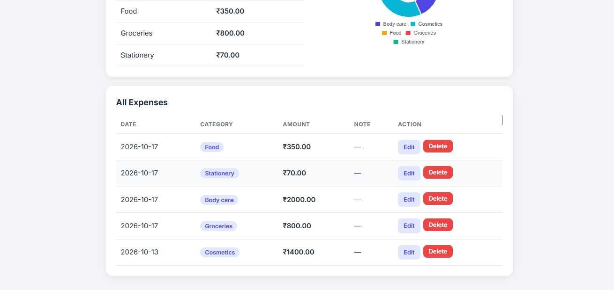

# Expense Tracker

A web app to record daily expenses and see where the money goes. Built with Python (Flask), SQLite, and JavaScript.

## Features
- Add, edit, and delete expenses (CRUD)
- Monthly total and category-wise summary using SQL `GROUP BY`
- Doughnut chart of spending by category (Chart.js)
- Form validation with JavaScript
- Responsive design with custom CSS

## Tech Stack
- **Backend:** Python, Flask
- **Database:** SQLite
- **Frontend:** HTML, CSS, JavaScript, Chart.js

## Screenshots





## How to Run
```
git clone https://github.com/durgasumathi-30/expense-tracker.git
cd expense-tracker
python -m venv venv
venv\Scripts\activate
pip install flask
python app.py
```
Open http://127.0.0.1:5000 in your browser.

## What I Learned
- Connecting a Flask backend to a SQLite database
- Writing SQL queries for INSERT, SELECT, UPDATE, DELETE, and GROUP BY
- Passing data from Python to JavaScript to draw charts

## Future Improvements
- User login
- Monthly budget limits
- Export to CSV
